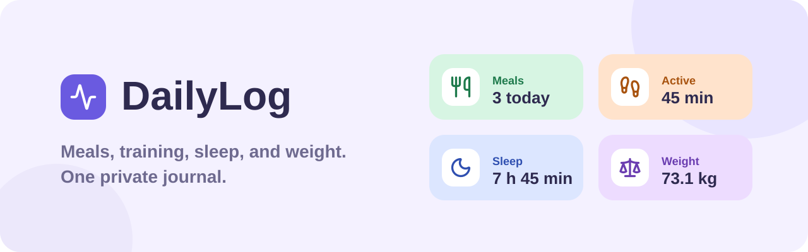

<div align="center">
  
</div>

# [DailyLog](https://demo.dailylog.pivi.dev/)

A single-owner web journal for meals, training, sleep, and body weight, built with Next.js 16, React, TypeScript, and SQLite. It has English and Italian interfaces, light and dark themes, and layouts from phone to desktop. It replaced an earlier Telegram bot and still reads that bot's SQLite database.

           

The [live demo](https://demo.dailylog.pivi.dev) runs the real app in your browser with sample data. Nothing leaves the browser, and any password signs you in. [daily-log/demo/README.md](daily-log/demo/README.md) explains how it is built.

## Tech Stack

- **App**: one Next.js 16 app with React Server Components and route handlers. There is no client state library and no CSS framework.
- **Data**: SQLite through `better-sqlite3` and a single repository class, with no ORM.
- **Validation**: Zod at every trust boundary.
- **Charts and exports**: Recharts for charts, `pdfkit` for PDF reports, and `write-excel-file` for XLSX workbooks.
- **UI**: Radix Select and Popover, react-day-picker, lucide-react icons, and the Nunito font bundled locally.
- **Demo**: a static export on GitHub Pages that runs the app on sql.js (SQLite compiled to WebAssembly).
- **Quality**: ESLint, Prettier, strict TypeScript, Vitest, and Playwright.
- **Hosting**: Docker Compose behind an HTTPS reverse proxy.

## Features

### Logging

- Log meals, training, sleep, and weigh-ins from one Add record sheet, now or backdated. The meal type, last activity, and last weight are prefilled.
- Run one training or sleep session at a time, then end or cancel it from Today.
- Keep a note for any day from Calendar.

### Reviewing

- Today shows totals per record type, a timeline, the running activity, and your logging streak.
- History searches, filters, edits, and deletes records. Deleted records stay in the trash for 30 days.
- Reports shows a 7-day summary, 14 nights of sleep, 30 days of training, and your full weight history, and exports any range as XLSX or PDF.
- Calendar browses past days.
- Profile tracks BMI and a weight goal.

### Settings and backups

- Back up the account to a JSON file and import it again from Settings.
- Choose UI language, report language, theme (light, dark, or system), weight unit (kg or lb), and 12- or 24-hour time separately.

## Getting Started

You need Node.js 22.12 or newer and npm 10 or newer.

```bash
cd daily-log
npm ci
cp .env.example .env    # then set APP_PASSWORD and SESSION_SECRET
npm run db:migrate
npm run dev
```

Open http://localhost:3000. Sign-in stays disabled until `APP_PASSWORD` is set.

`npm ci` also installs the git hooks (see [Development checks](#development-checks)).

### Configuration

[`src/core/config/env.ts`](daily-log/src/core/config/env.ts) validates every variable with Zod when the server starts. An invalid value stops startup and names the variable, never its value.

| Variable          | Default                    | Notes                                                                     |
| ----------------- | -------------------------- | ------------------------------------------------------------------------- |
| `APP_PASSWORD`    | none                       | First password. 12 to 256 characters. Unused once Settings changes it.    |
| `SESSION_SECRET`  | `APP_PASSWORD` (dev only)  | Signs session cookies. 32+ characters. Required in production.            |
| `APP_USER_ID`     | `1`                        | Owner ID on every row. Set it to the old Telegram user ID when migrating. |
| `ALLOWED_USER_ID` | none                       | The bot's name for `APP_USER_ID`. Still accepted.                         |
| `TIMEZONE`        | `Europe/Berlin`            | IANA zone used for calendar days and form times.                          |
| `DATABASE_PATH`   | `data/dailylogbot.sqlite3` | SQLite file. The directory is created if missing.                         |
| `LOG_LEVEL`       | `info`                     | `debug`, `info`, `warn`, or `error`. Uppercase bot values also work.      |
| `BUGSINK_DSN`     | none                       | Bugsink project DSN. When set, unexpected server errors are reported.     |

## Development checks

From `daily-log/`:

```bash
npm run format:check   # Prettier
npm run lint           # ESLint, including import boundaries
npm run typecheck      # strict TypeScript
npm test               # Vitest unit and SQLite integration tests
npm run test:e2e       # Playwright, desktop and mobile Chromium
npm run build          # production build
npm run quality        # everything above except e2e
```

The git hooks in `.githooks/` run automatically. The pre-commit hook runs Prettier and ESLint on staged files, and the pre-push hook runs the format check, lint, typecheck, and unit tests.

CI runs the same checks plus the demo build, Playwright, `npm audit`, a Trivy container scan with a health check, and a Gitleaks history scan.

## Deployment

### Docker

From the repository root:

```bash
cp daily-log/.env.example daily-log/.env    # set APP_PASSWORD and SESSION_SECRET
docker compose up --build --detach
```

Compose publishes the app on http://localhost:14141, reachable from this machine only, and keeps the database in the `dailylog_data` volume at `/data/dailylog.sqlite3`.

For production:

- Put an HTTPS reverse proxy in front. Over plain HTTP, Chrome flags every PDF and Excel export as an insecure download, and serving the app over HTTPS is the only fix. On a home network, `tailscale serve 14141` or a Caddy proxy with a real domain both work. The proxy must overwrite `X-Forwarded-For` with the real client address instead of appending to it.
- Run a single instance. SQLite and the in-memory login limiter assume one process.
- Back up the volume and test restores.

[SECURITY.md](SECURITY.md) has the deployment baseline.

### Demo

The Release workflow redeploys the demo on GitHub Pages with every release. [daily-log/demo/README.md](daily-log/demo/README.md) has the build commands.

## Architecture

- Pages are Server Components that read from the repository directly. Client components only handle interaction.
- Every API route is wrapped in `authenticatedRoute` or `publicRoute` from [`src/core/http/api.ts`](daily-log/src/core/http/api.ts). The wrapper checks the origin and session and maps errors to a single envelope: `{ error: { code, message, requestId, fields? } }`. `readJson` and `readQuery` parse input with the route's Zod schema.
- [`LogbookRepository`](daily-log/src/infrastructure/database/logbook-repository.ts) scopes every query by owner ID. The database also enforces the important rules: one open activity, valid ranges, and weight bounds.

ESLint enforces the import direction. [CODING_GUIDELINES.md](CODING_GUIDELINES.md) has the full rules, and [docs/DESIGN.md](docs/DESIGN.md) has the design system (colours, components, layouts, copy, exports).

## Runtime validation

Zod validates every input that crosses a trust boundary, once, before it reaches domain code:

| Boundary                              | Schema                                                                                                                                                                                                   |
| ------------------------------------- | -------------------------------------------------------------------------------------------------------------------------------------------------------------------------------------------------------- |
| Request bodies, queries, route params | The owning feature's `schemas.ts`, e.g. [`logbook`](daily-log/src/features/logbook/schemas.ts), [`auth`](daily-log/src/features/auth/schemas.ts), [`profile`](daily-log/src/features/profile/schemas.ts) |
| Backup import                         | [`src/features/backup/schemas.ts`](daily-log/src/features/backup/schemas.ts), built from the request schemas                                                                                             |
| Environment                           | [`src/core/config/env.ts`](daily-log/src/core/config/env.ts)                                                                                                                                             |
| Session cookie payload                | [`src/core/security/session.ts`](daily-log/src/core/security/session.ts)                                                                                                                                 |
| Locale and theme cookies              | [`src/core/preferences/preference-cookies.ts`](daily-log/src/core/preferences/preference-cookies.ts)                                                                                                     |

Request schemas reject unknown keys. Larger contracts reuse smaller ones instead of repeating fields: a backup file is validated with the same entry, settings, and profile schemas the API uses. TypeScript types for validated input come from `z.infer`, so no hand-written copy can drift. Relational rows are not parsed again, because the schema's `CHECK` constraints already guarantee their shape. JSON documents stored in the database (diet, meal plan) are parsed with their Zod schemas when read.

## Database

`npm run db:migrate` creates or upgrades the schema and prints the resulting version. The app also migrates on first database access. Migrations are additive.

Before upgrading an older database, DailyLog copies it next to the original as `<file>.pre-web-v<old version>.bak`, for example `data/dailylogbot.sqlite3.pre-web-v2.bak`.

## Security model

- There is one owner and one password. Sessions are signed, HttpOnly, and `SameSite=Lax`, and expire after seven idle days (renewed at most once a day while in use). Signing out or changing the password ends every session on every device.
- Set `SESSION_SECRET`. In production the server refuses to start without it when `APP_PASSWORD` is set. In development, sessions fall back to being signed with `APP_PASSWORD`, which a password change in Settings does not rotate, and the server logs `config.session_secret_is_password`.
- Pages redirect to sign-in without a valid session, checked in the proxy before anything renders. Every mutating request must come from the same origin.
- Failed sign-ins are throttled per client (8 per 15 minutes) and globally (60 per 15 minutes). While the global cap lasts it also blocks the owner's sign-in, though existing sessions keep working. The per-client limit reads `X-Forwarded-For`, so it only holds when clients reach the app through a proxy that overwrites that header.
- SQL is always parameterized. Exported spreadsheet cells are protected against formula injection.
- The proxy sets a per-request CSP that only runs scripts carrying its nonce. HSTS (in production), frame denial, and `nosniff` are set in [`next.config.ts`](daily-log/next.config.ts).
- Logs are structured JSON and never contain journal text, weights, passwords, or cookies.

## Versioning and releases

Releases are automatic and follow [Semantic Versioning](https://semver.org/).
Every pull request that changes code bumps the version in `daily-log/package.json`, as
[AGENTS.md](./AGENTS.md#versioning-and-releases) describes. When CI passes on
`main`, the Release workflow tags the new version, publishes the
[GitHub release](https://github.com/thisispivi/DailyLog/releases), and redeploys the [demo](https://demo.dailylog.pivi.dev/).
Dependabot alerts and security updates are on; the `fix-vulnerabilities` skill
triages them.

## Documentation

| Document                                                    | Covers                                                                       |
| ----------------------------------------------------------- | ---------------------------------------------------------------------------- |
| [Coding guidelines](CODING_GUIDELINES.md)                   | Structure, import direction, validation, API and database rules, tests       |
| [Design system](docs/DESIGN.md)                             | Colours, typography, components, layouts, charts, copy, and exports          |
| [Agent instructions](AGENTS.md)                             | Workflow rules for coding assistants, versioning, commits, and pull requests |
| [Security policy](SECURITY.md)                              | Reporting a vulnerability and the production deployment baseline             |
| [Demo](daily-log/demo/README.md)                            | How the browser demo runs the real app, and its commands                     |
| [Architecture decisions](docs/architecture/)                | ADRs for Next.js with SQLite, owner authentication, and retiring Telegram    |
| [Releases](https://github.com/thisispivi/DailyLog/releases) | Release notes for every version                                              |

## Project Structure

The application, its dependencies, tests, build configuration, and Dockerfile live in `daily-log/`. Repository documentation, GitHub workflows, and Git hooks stay at the root. Run npm commands from `daily-log/`.

```text
daily-log/src/
├── app/              Routes: pages, layouts, API route handlers
├── features/<name>/  Product features: domain logic, schemas, feature UI
├── ui/               Shared presentational pieces: logo, record-type icons, Sheet, Select, DateTimeField, toast
├── core/<concern>/   Cross-cutting policy: config, http, i18n, observability, preferences, security, time
└── infrastructure/   Adapters. Today only the SQLite database
```

## License

[MIT](LICENSE)
