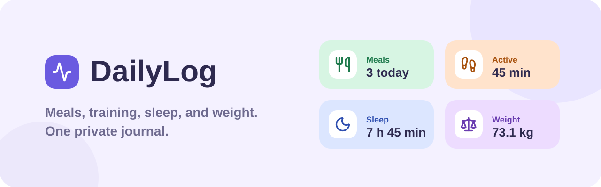

<div align="center">
  
</div>

# DailyLog

A private, single-owner web journal for meals, training, sleep, and body weight. English and Italian, light and dark, phone to desktop.

It replaced an earlier Telegram bot and still reads that bot's SQLite database.

## What it does

- Log meals, training, sleep, and weigh-ins from one **Add record** sheet, now or backdated. The meal type, last activity, and last weight are prefilled.
- See the day on **Today**: totals per record type, a timeline, the running activity, and your logging streak.
- Run one training or sleep session at a time, then end or cancel it from **Today**.
- Search, filter, edit, and delete records in **History**. Deleted records stay in the trash for 30 days.
- See a 7-day summary, 14 nights of sleep, and 30-day weight and training trends in **Reports**, and export any range as XLSX or PDF.
- Choose UI language, report language, theme (light, dark, or system), and weight unit (kg or lb) separately.

## Quick start

Requires Node.js 20.9+ and npm 10+.

```bash
npm ci
cp .env.example .env    # then set APP_PASSWORD and SESSION_SECRET
npm run db:migrate
npm run dev
```

Open http://localhost:3000. Sign-in stays disabled until `APP_PASSWORD` is set.

`npm ci` also installs the git hooks (see [Quality checks](#quality-checks)).

## Configuration

All variables are validated with Zod in [`src/core/config/env.ts`](src/core/config/env.ts) when the server starts. Invalid values stop startup with the variable name, never its value.

| Variable          | Default                    | Notes                                                                     |
| ----------------- | -------------------------- | ------------------------------------------------------------------------- |
| `APP_PASSWORD`    | none                       | Required to sign in. 12 to 256 characters.                                |
| `SESSION_SECRET`  | `APP_PASSWORD`             | Signs session cookies. Use a separate value of 32+ characters.            |
| `APP_USER_ID`     | `1`                        | Owner ID on every row. Set it to the old Telegram user ID when migrating. |
| `ALLOWED_USER_ID` | none                       | The bot's name for `APP_USER_ID`. Still accepted.                         |
| `TIMEZONE`        | `Europe/Berlin`            | IANA zone used for calendar days and form times.                          |
| `DATABASE_PATH`   | `data/dailylogbot.sqlite3` | SQLite file. The directory is created if missing.                         |
| `LOG_LEVEL`       | `info`                     | `debug`, `info`, `warn`, or `error`. Uppercase bot values also work.      |

## Architecture

One Next.js 16 app with a SQLite database. No ORM, no client state library, no CSS framework, no chart library.

```text
src/
├── app/              Routes: pages, layouts, API route handlers
├── features/<name>/  Product features: domain logic, schemas, feature UI
├── ui/               Shared presentational pieces: logo, record-type icons, sheet
├── core/<concern>/   Cross-cutting policy: config, http, i18n, security, time, logging
└── infrastructure/   Adapters. Today only the SQLite database
```

- Pages are Server Components that read from the repository directly. Client components only handle interaction.
- Every API route is wrapped in `authenticatedRoute` or `publicRoute` from [`src/core/http/api.ts`](src/core/http/api.ts). The wrapper checks the origin and session, parses JSON, and maps errors to a single envelope: `{ error: { code, message, requestId, fields? } }`.
- [`LogbookRepository`](src/infrastructure/database/logbook-repository.ts) scopes every query by owner ID. The database also enforces the important rules: one open activity, valid ranges, and weight bounds.

ESLint enforces the import direction. The full rules are in [docs/CODING_STANDARDS.md](docs/CODING_STANDARDS.md).

## Runtime validation

Zod validates every input that crosses a trust boundary, once, before it reaches domain code:

| Boundary                   | Schema                                                                                     |
| -------------------------- | ------------------------------------------------------------------------------------------ |
| Request bodies and queries | [`src/features/logbook/schemas.ts`](src/features/logbook/schemas.ts), strict               |
| Environment                | [`src/core/config/env.ts`](src/core/config/env.ts)                                         |
| Session cookie payload     | [`src/core/security/session.ts`](src/core/security/session.ts)                             |
| Locale and theme cookies   | [`src/core/preferences/preference-cookies.ts`](src/core/preferences/preference-cookies.ts) |

Request schemas reject unknown keys. TypeScript types for validated input come from `z.infer`, so there is no hand-written copy to drift. Database rows are not re-parsed because the schema's `CHECK` constraints already guarantee their shape.

## Quality checks

```bash
npm run format:check   # Prettier
npm run lint           # ESLint, including import boundaries
npm run typecheck      # strict TypeScript
npm test               # Vitest unit and SQLite integration tests
npm run test:e2e       # Playwright, desktop and mobile Chromium
npm run build          # production build
npm run quality        # everything above except e2e
```

Git hooks in `.githooks/` run automatically:

- **pre-commit**: Prettier and ESLint on staged files.
- **pre-push**: format check, lint, typecheck, and unit tests.

CI runs the same checks plus the production build, Playwright, `npm audit`, a Trivy container scan, and a Gitleaks history scan.

## Database

`npm run db:migrate` creates or upgrades the schema (currently version 5). The app also migrates on first database access. Migrations are additive.

Before upgrading an older database, DailyLog copies it next to the original, for example `data/dailylogbot.sqlite3.pre-web-v2.bak`.

## Docker

```bash
cp .env.example .env    # set APP_PASSWORD and SESSION_SECRET
docker compose up --build --detach
```

Compose publishes the app on http://localhost:14141 and keeps the database in the `dailylog_data` volume at `/data/dailylog.sqlite3`.

For production:

- Put an HTTPS reverse proxy in front. Over plain HTTP, Chrome flags every PDF and Excel export as an insecure download; the only fix is serving the app over HTTPS. On a home network, `tailscale serve 14141` or a Caddy proxy with a real domain both work.
- Run a single instance. SQLite and the in-memory login limiter assume one process.
- Back up the volume and test restores.

See [SECURITY.md](SECURITY.md) for the deployment baseline.

## Security model

- One owner, one password. Sessions are signed, HttpOnly, `SameSite=Strict`, and last seven days.
- Every mutating request must come from the same origin.
- Failed sign-ins are throttled per client and globally.
- SQL is always parameterized. Exported spreadsheet cells are protected against formula injection.
- CSP, HSTS (in production), frame denial, and `nosniff` are set in [`next.config.ts`](next.config.ts).
- Logs are structured JSON and never contain journal text, weights, passwords, or cookies.

## License

[MIT](LICENSE)
